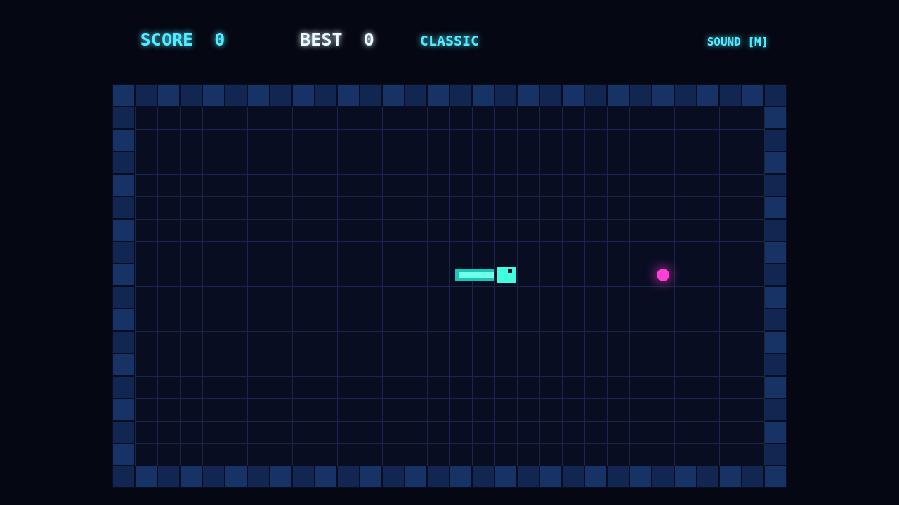

# Coil

Coil is a neon grid serpent built around one dangerous idea: the shortest route is usually the highest-scoring one. Guide the luminous coil through a sealed arena, swallowing pulses and leaving an ever-longer trail behind you.

Every pulse makes the serpent grow. Walls and your own body end the run, so each turn commits you to a path you may have to escape several moves later.

Eat again before the combo bar drains to climb toward a ×5 multiplier. Hesitate and it falls back to one; push too hard and your own coil closes in.

Use the arrow keys or WASD to steer, P or Escape to pause, and M to mute. Menus also work with pointer and touch.

